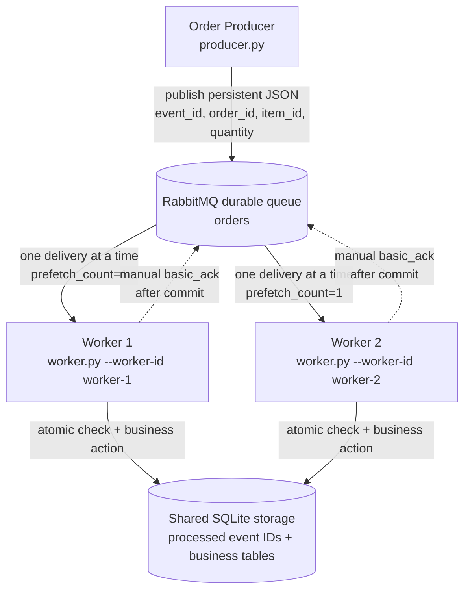

# CMPE 273 — Module 5: Asynchronous Messaging with RabbitMQ

A small asynchronous order-processing system: an **Order Producer** publishes order
messages to a RabbitMQ queue, and two independent **Order Workers** compete to consume
them, acknowledge them manually, survive a crash before acknowledgment, and use
`event_id`-based idempotency so a redelivered or duplicated message never runs the
business action twice.

---

## 1. Overview

RabbitMQ decouples the producer from the workers. The producer only needs to know the
queue name. It does not know how many workers exist, whether they are running right now,
or how long processing takes. Workers can be added, removed, or crash without the producer
noticing.

The project demonstrates:

| Concept | How it is implemented |
|---|---|
| Durable queue + persistent messages | `queue_declare(durable=True)` in producer and workers; `delivery_mode=Persistent` |
| Competing consumers | Two separate `worker.py` processes consume from the same `orders` queue |
| Fair dispatch | `basic_qos(prefetch_count=1)`, so a busy worker holds at most one unacked message |
| Manual acknowledgments | `basic_consume(auto_ack=False)`; `basic_ack` sent only after the SQLite commit |
| Failure recovery | `--crash-before-ack` kills a worker with `os._exit()` after commit, before ACK; RabbitMQ requeues and redelivers |
| Idempotent processing | Business action + processed-event record written in one SQLite `BEGIN IMMEDIATE` transaction keyed by `event_id` |

Publisher confirms (`channel.confirm_delivery()`) are also enabled in the producer. They
are a different mechanism: a **publisher confirm** is the broker telling the *producer* it
accepted a message, while a **consumer ACK** is a *worker* telling the broker it finished
processing a delivery.

## 2. Architecture Diagram



| Component | Role |
|---|---|
| **Order Producer** (`producer.py`) | Builds and validates order messages, serializes them as UTF-8 JSON, and publishes them as persistent messages to the `orders` queue. |
| **RabbitMQ** (Docker) | Stores messages durably. It hands each delivery to exactly one consumer at a time, tracks unacknowledged deliveries, and requeues them if the consumer's connection dies. |
| **Worker 1 / Worker 2** (`worker.py`) | Independent OS processes with their own connections. Each one receives a delivery, checks `event_id`, runs the business action if the event is new, and then ACKs. |
| **Shared SQLite storage** (`storage.py`, `orders.db`) | The `processed_events` table (`event_id` PRIMARY KEY), plus the simulated business tables `order_fulfillments` and `inventory_reservations`. Both workers open the same file. |

## 3. Project Structure

```text
cmpe273-asynchronous-messaging/
├── producer.py          # Order Producer CLI + message contract (build/validate/serialize/parse)
├── worker.py            # Order Worker CLI: manual ACK, duplicate detection, crash-before-ack mode
├── storage.py           # SQLite idempotency store; atomic "process event once" transaction
├── config.py            # RabbitMQ/SQLite settings (env-overridable), connection + queue declaration
├── demo.py              # Automated end-to-end demo of all scenarios; writes evidence/*.log
├── docker-compose.yml   # RabbitMQ 4 with the management plugin
├── requirements.txt     # pika, pytest
├── pytest.ini           # test paths and the "integration" marker
├── tests/
│   ├── test_producer.py     # unit: message fields, UUIDs, validation, JSON, publish properties
│   ├── test_worker.py       # unit: ACK ordering, duplicates, crash-before-ack, malformed messages
│   ├── test_storage.py      # unit: idempotency, persistence, concurrent SQLite connections
│   └── test_integration.py  # live RabbitMQ: competing consumers, crash + redelivery, duplicates
└── evidence/
    ├── successful_processing.log
    ├── competing_consumers.log
    ├── failure_redelivery.log
    ├── duplicate_handling.log
    └── test_results.log
```

`orders.db` (manual runs) and `demo_orders.db` (demo runs) are created at runtime and are
ignored by Git.

## 4. Prerequisites

- **Python 3.11+** (developed and verified with Python 3.13.14 on Windows 11)
- **Docker Desktop** with Docker Compose v2 (`docker compose ...`)
- **Git**
- Python dependencies from `requirements.txt`: `pika` (RabbitMQ client) and `pytest`

## 5. Installation and Setup

```bash
git clone <your-repo-url> cmpe273-asynchronous-messaging
cd cmpe273-asynchronous-messaging

docker compose up -d
python -m pip install -r requirements.txt
```

Optionally, use a virtual environment first:

```bash
python -m venv .venv
source .venv/bin/activate        # macOS / Linux
.venv\Scripts\Activate.ps1       # Windows PowerShell
```

**Verify RabbitMQ started.** Wait until the container reports `(healthy)`:

```bash
docker compose ps
```

```text
NAME               IMAGE                   COMMAND                  SERVICE    CREATED         STATUS                   PORTS
cmpe273-rabbitmq   rabbitmq:4-management   "docker-entrypoint.s…"   rabbitmq   7 seconds ago   Up 6 seconds (healthy)   0.0.0.0:5672->5672/tcp, [::]:5672->5672/tcp, 0.0.0.0:15672->15672/tcp, [::]:15672->15672/tcp
```

**Management UI:** <http://localhost:15672>

| Setting | Value |
|---|---|
| Username | `cmpe273` |
| Password | `cmpe273` |
| AMQP endpoint | `localhost:5672` |

These are **local-development credentials only**, defined in `docker-compose.yml`. A named
user is used because RabbitMQ's built-in `guest` account only accepts loopback
connections, and connections forwarded into a container do not count as loopback.

All settings can be overridden with environment variables: `RABBITMQ_HOST`,
`RABBITMQ_PORT`, `RABBITMQ_USER`, `RABBITMQ_PASSWORD`, `RABBITMQ_VHOST`, `ORDERS_QUEUE`
(default `orders`), and `ORDERS_DB_PATH` (default `orders.db`).

If RabbitMQ is not running, every program prints a clear message instead of a traceback:

```text
[PRODUCER] ERROR Could not connect to RabbitMQ at amqp://cmpe273@localhost:5999/. Is the broker running? Start it with 'docker compose up -d' and wait until 'docker compose ps' reports it as healthy. (details: AMQPConnectionError: (AMQPConnectorSocketConnectError: ConnectionRefusedError(10061, 'Unknown error'),))
```

(Recorded with `RABBITMQ_PORT=5999` to simulate an unavailable broker.)

## 6. Running the Producer and Workers

Open three terminals in the repository root. Each command starts an **independent
operating-system process** with its own RabbitMQ connection.

Terminal 1:

```bash
python worker.py --worker-id worker-1
```

Terminal 2:

```bash
python worker.py --worker-id worker-2
```

Terminal 3:

```bash
python producer.py --count 10
```

Stop a worker with **Ctrl+C**. Any message it had not yet ACKed is returned to the queue.

### Command reference

```text
producer.py
  --count N                 publish N generated orders (default 10), IDs ORD-001, ORD-002, ...
  --start N / --prefix P    first order number / order ID prefix for generated orders
  --order-id ID --item-id ID --quantity N [--event-id ID] [--repeat N]
                            publish one explicit order; --repeat publishes the identical
                            message (same event_id) N times

worker.py
  --worker-id ID            required, e.g. worker-1
  --processing-delay SECS   simulated processing time (default 0.5)
  --db-path PATH            shared SQLite file (default orders.db)
  --crash-before-ack        TEST MODE: exit abruptly after committing one event, before ACK
  --crash-on-event-id ID    only crash on this event_id (otherwise: first new event)
  --crash-release-file PATH wait for this file to exist before crashing (used by demo.py)

storage.py                  print processed events in orders.db
storage.py --reset          explicitly delete all rows (never done automatically)
```

The producer rejects invalid input before connecting, for example
`--quantity 0` prints `[PRODUCER] ERROR invalid order: quantity must be positive, got 0`.

## 7. Successful Message Processing

Each order message is a JSON object with exactly four fields:

```json
{"event_id": "9045fd74-6ad1-4805-84ba-928faa34451b", "item_id": "item_102", "order_id": "ORD-001", "quantity": 3}
```

Real output from [`evidence/successful_processing.log`](evidence/successful_processing.log)
(timestamps added by `demo.py`):

```text
19:17:36.633 [worker-1] READY pid=30652 queue=orders prefetch_count=1 auto_ack=False processing_delay=0.3s
19:17:36.871 [worker-1] RECEIVED order_id=ORD-001 event_id=9045fd74-6ad1-4805-84ba-928faa34451b redelivered=False
19:17:36.871 [PRODUCER] Published event_id=9045fd74-6ad1-4805-84ba-928faa34451b order_id=ORD-001 item_id=item_102 quantity=3
19:17:36.872 [worker-1] PROCESSING order_id=ORD-001 event_id=9045fd74-6ad1-4805-84ba-928faa34451b item_id=item_102 quantity=3
19:17:36.914 [PRODUCER] Published event_id=228a9f00-0bbe-42e3-b35c-846cbdc32ceb order_id=ORD-002 item_id=item_105 quantity=3
19:17:36.958 [PRODUCER] Published event_id=6599d191-c7c2-415f-bad9-3eaa439cb122 order_id=ORD-003 item_id=item_104 quantity=5
19:17:37.178 [worker-1] COMPLETED order_id=ORD-001 event_id=9045fd74-6ad1-4805-84ba-928faa34451b
19:17:37.178 [worker-1] ACK event_id=9045fd74-6ad1-4805-84ba-928faa34451b
19:17:37.179 [worker-1] RECEIVED order_id=ORD-002 event_id=228a9f00-0bbe-42e3-b35c-846cbdc32ceb redelivered=False
...
```

(The worker's `RECEIVED` line can appear a fraction of a millisecond before the producer's
`Published` line because the producer prints after the broker confirms the publish.)

What happens for each delivery:

1. **RECEIVED**: RabbitMQ pushes the delivery to the worker. With `auto_ack=False` the
   broker still considers the message *unacknowledged* and owned by this worker.
2. **PROCESSING**: the event is new, so the worker runs its simulated processing delay.
3. **COMPLETED**: one SQLite transaction inserts an `order_fulfillments` row, increments
   `inventory_reservations`, and inserts the `processed_events` row, then commits.
4. **ACK**: only now does the worker call `basic_ack(delivery_tag)` on the channel that
   received the delivery. RabbitMQ then deletes the message. Because of
   `prefetch_count=1`, the next message is delivered only after this ACK.

## 8. Competing Consumers

Two workers ran as separate processes (pid 38752 and 27168), and RabbitMQ reported two
consumers on the `orders` queue. Ten orders were published. Real excerpt from
[`evidence/competing_consumers.log`](evidence/competing_consumers.log):

```text
19:17:38.201 [worker-1] READY pid=38752 queue=orders prefetch_count=1 auto_ack=False processing_delay=0.5s
19:17:38.405 [worker-2] READY pid=27168 queue=orders prefetch_count=1 auto_ack=False processing_delay=0.5s
19:17:38.485 [demo] CHECK PASS: RabbitMQ reports 2 consumers on queue=orders
19:17:38.706 [worker-1] RECEIVED order_id=ORD-011 event_id=3ff041da-fb5f-458b-80eb-acdabd1ccc9d redelivered=False
19:17:38.750 [worker-2] RECEIVED order_id=ORD-012 event_id=c612103b-b8f4-4b11-8054-9cfec802e9ce redelivered=False
19:17:39.216 [worker-1] COMPLETED order_id=ORD-011 event_id=3ff041da-fb5f-458b-80eb-acdabd1ccc9d
19:17:39.216 [worker-1] ACK event_id=3ff041da-fb5f-458b-80eb-acdabd1ccc9d
19:17:39.217 [worker-1] RECEIVED order_id=ORD-013 event_id=6b96365c-d1e9-4051-8027-55a81e8104a4 redelivered=False
19:17:39.258 [worker-2] COMPLETED order_id=ORD-012 event_id=c612103b-b8f4-4b11-8054-9cfec802e9ce
19:17:39.259 [worker-2] ACK event_id=c612103b-b8f4-4b11-8054-9cfec802e9ce
19:17:39.260 [worker-2] RECEIVED order_id=ORD-014 event_id=2cbb38c6-a7dd-4805-abb6-63e0ffbccefb redelivered=False
...
19:17:42.342 [demo] worker-1 completed 5 orders, worker-2 completed 5 orders
19:17:42.342 [demo] CHECK PASS: each event was COMPLETED by exactly one worker (no broadcast, no loss)
19:17:42.342 [demo] CHECK PASS: each event received exactly one ACK
```

**Interpretation.** A queue with several consumers is a *work queue*, not a broadcast. Each
delivery is assigned to **one** consumer, so ORD-011 went only to worker-1 and ORD-012 only
to worker-2. With `prefetch_count=1`, a worker gets its next message only after ACKing the
current one, so the busy worker never accumulates a backlog while the other sits idle.
In this run the split was 5/5 because both workers had the same 0.5 s delay. The split is
not guaranteed to be strictly alternating: it depends on which worker is free when a
message is ready. The SQLite state recorded in the log shows 10 `processed_events` rows,
each with `business_actions=1`, and the `processed_by` column shows both workers.

## 9. Failure and Redelivery

### Reproduce manually (three terminals)

Start with an empty store so `evt-100` is new: `python storage.py --reset`.

1. **Terminal 1**: crash-enabled worker with a long delay, so you have time to start worker 2:
   ```bash
   python worker.py --worker-id worker-1 --crash-before-ack --crash-on-event-id evt-100 --processing-delay 10
   ```
2. **Terminal 3**: publish the target order. Only worker-1 is subscribed, so it receives it:
   ```bash
   python producer.py --event-id evt-100 --order-id ORD-100 --item-id item_100 --quantity 1
   ```
3. **Terminal 2**, within 10 seconds:
   ```bash
   python worker.py --worker-id worker-2
   ```
4. Worker-1 commits the business action, prints `SIMULATED CRASH BEFORE ACK`, and exits.
   Worker-2 immediately receives the redelivered message and skips it as a duplicate.
5. **Terminal 3**: recovery check. Worker-2 processes a new order normally:
   ```bash
   python producer.py --order-id ORD-101 --item-id item_101 --quantity 2
   ```

This exact procedure was run and verified: worker-1 exited after `COMPLETED`, worker-2
logged `redelivered=True`, then `DUPLICATE DETECTED` and `ACK`, and then processed ORD-101.
`orders.db` showed one business action for `evt-100`. `python demo.py` runs the same
scenario automatically.

### Recorded evidence

Real excerpt from [`evidence/failure_redelivery.log`](evidence/failure_redelivery.log):

```text
19:17:42.688 [worker-1] READY pid=22796 queue=orders prefetch_count=1 auto_ack=False processing_delay=0.5s crash_before_ack=on target=evt-100
19:17:42.930 [worker-1] RECEIVED order_id=ORD-100 event_id=evt-100 redelivered=False
19:17:42.932 [worker-1] PROCESSING order_id=ORD-100 event_id=evt-100 item_id=item_100 quantity=1
19:17:43.438 [worker-1] COMPLETED order_id=ORD-100 event_id=evt-100
19:17:43.438 [worker-1] CRASH ARMED waiting for release file crash-release-62514cc8.tmp
19:17:43.451 [demo] CHECK PASS: processed-event record was committed to SQLite BEFORE the crash
19:17:43.636 [worker-2] READY pid=37224 queue=orders prefetch_count=1 auto_ack=False processing_delay=0.5s
19:17:43.717 [demo] before crash: queue ready=0 consumers=2 (target message is unacked, held by worker-1)
19:17:43.740 [worker-1] SIMULATED CRASH BEFORE ACK
19:17:43.743 [worker-2] RECEIVED order_id=ORD-100 event_id=evt-100 redelivered=True
19:17:43.744 [demo] worker-1 process exited with code 3
19:17:43.745 [worker-2] DUPLICATE DETECTED event_id=evt-100
19:17:43.745 [worker-2] SKIPPING BUSINESS ACTION
19:17:43.745 [worker-2] ACK event_id=evt-100
19:17:43.848 [demo] recovery check: publishing a new order after the crash
19:17:44.070 [worker-2] RECEIVED order_id=ORD-101 event_id=89173f39-fc04-4708-b4a3-6cb59197f464 redelivered=False
19:17:44.578 [worker-2] COMPLETED order_id=ORD-101 event_id=89173f39-fc04-4708-b4a3-6cb59197f464
19:17:44.578 [worker-2] ACK event_id=89173f39-fc04-4708-b4a3-6cb59197f464
```

SQLite after the scenario: `evt-100 processed_by=worker-1 business_actions=1` and
`item_100 reserved_quantity=1`.

**Why RabbitMQ redelivers.** A delivery that has not been ACKed still belongs to the broker.
When worker-1's process dies, the OS closes its TCP socket. RabbitMQ sees the connection
close and puts every unacknowledged delivery on that channel back on the queue. It marks
these messages `redelivered=True` and gives them to another consumer. No timeout or retry
logic is needed in the application. Worker-2 had been idle with `prefetch_count=1`, so it
received `evt-100` within about 3 ms of the crash.

**Why the crash happens after the commit.** The crash is placed in the worst possible
window: the business action is durable, but RabbitMQ was never told. This is the window
that makes at-least-once delivery produce a duplicate, and the duplicate check exists to
handle it. Only the worker started with `--crash-before-ack` can crash. It crashes at most
once, only on the designated `event_id`, and never on a duplicate.

**How the demo avoids timing races.** `demo.py` starts the crash-enabled worker alone, so
it is guaranteed to receive the target. Once worker-1 logs `COMPLETED`, the demo confirms
the commit in SQLite and starts worker-2. When worker-2 logs `READY`, the demo creates
the barrier file named by `--crash-release-file`, which releases worker-1 to crash. The
sequence is controlled by log output and the barrier file, not by sleep statements.

## 10. Duplicate Handling

### Approach

`storage.process_event_once()` runs this sequence in a single SQLite transaction:

```text
BEGIN IMMEDIATE                      -- take the database write lock first
SELECT 1 FROM processed_events WHERE event_id = ?
  -> found:   ROLLBACK, return False (duplicate)
  -> missing: INSERT order_fulfillments ...          -- the simulated business action
              UPSERT inventory_reservations += qty  -- the simulated business action
              INSERT processed_events (event_id PRIMARY KEY, order_id, worker_id, processed_at)
              COMMIT, return True
```

The check and the write are **not** two separate, unprotected steps. `BEGIN IMMEDIATE`
acquires SQLite's write lock *before* the check. If two workers race on the same
`event_id`, the second one blocks for up to the 30 s busy timeout. When it gets the lock,
it sees the committed row and returns "duplicate". The `PRIMARY KEY` on `event_id` is a
second safeguard, and an `IntegrityError` is also treated as a duplicate. The business
action and the processed-event record commit together or not at all, so the business
action can never be recorded without the event, or the event without the action.

The worker also performs a quick read-only `is_event_processed()` pre-check when a message
arrives, so that already-completed events skip the simulated processing delay. That
pre-check is only an optimization; the transaction above is the authoritative check.

Duplicates are still **ACKed**. The event is known to be complete, so removing the extra
copy from the queue is correct. A NACK with requeue would loop forever.

### Recorded evidence

The same message (`event_id=evt-200`) was published twice while both workers were running,
and then a third, late copy was published. Real excerpt from
[`evidence/duplicate_handling.log`](evidence/duplicate_handling.log):

```text
19:17:45.566 [worker-1] RECEIVED order_id=ORD-200 event_id=evt-200 redelivered=False
19:17:45.568 [worker-1] PROCESSING order_id=ORD-200 event_id=evt-200 item_id=item_200 quantity=2
19:17:45.610 [worker-2] RECEIVED order_id=ORD-200 event_id=evt-200 redelivered=False
19:17:45.611 [worker-2] PROCESSING order_id=ORD-200 event_id=evt-200 item_id=item_200 quantity=2
19:17:46.075 [worker-1] COMPLETED order_id=ORD-200 event_id=evt-200
19:17:46.075 [worker-1] ACK event_id=evt-200
19:17:46.115 [worker-2] DUPLICATE DETECTED event_id=evt-200 (committed by another worker first)
19:17:46.115 [worker-2] SKIPPING BUSINESS ACTION
19:17:46.115 [worker-2] ACK event_id=evt-200
19:17:46.129 [demo] publishing a third, late copy of evt-200 after the first two were ACKed
19:17:46.350 [worker-1] RECEIVED order_id=ORD-200 event_id=evt-200 redelivered=False
19:17:46.352 [worker-1] DUPLICATE DETECTED event_id=evt-200
19:17:46.352 [worker-1] SKIPPING BUSINESS ACTION
19:17:46.352 [worker-1] ACK event_id=evt-200
19:17:47.366 [demo] deliveries received=3 completed=1 duplicates=2 skipped=2
```

SQLite afterward: one `processed_events` row for `evt-200`, `business_actions=1`, and
`item_200 reserved_quantity=2`. Without idempotency, the reserved quantity would have been 6.

This run shows both detection paths:

- **Concurrent duplicate.** The two copies were delivered to *different* workers at the same
  time, so both passed the fast pre-check and both started processing. Worker-1 committed
  first. When worker-2 reached the transaction, the row already existed, so it skipped the
  business action. This is the race that the atomic transaction exists to prevent.
- **Late duplicate.** The third copy arrived after the event was complete. The fast
  pre-check caught it immediately, without the processing delay. A redelivery after a
  crash takes the same path, as shown in Section 9.

Which worker processes the first copy depends on timing, and the demo's checks do not
assume either order.

**Scope of the guarantee.** This gives idempotency for the *local transactional simulation*,
because the business action and the dedup record live in the same database transaction.
It is **not** a universal exactly-once guarantee. If the business action were an external
side effect (charging a card, sending an email), it could not join the SQLite transaction.
A crash between that side effect and the commit could repeat it unless the external system
also accepted an idempotency key.

### Malformed messages

A message that is not valid UTF-8 JSON, or that fails validation (missing fields,
non-positive quantity), is logged as `MALFORMED MESSAGE` and rejected with
`basic_nack(requeue=False)`, so it cannot cause an infinite redelivery loop. If processing
fails unexpectedly, for example with a SQLite error, nothing is committed. The worker
requeues the message once, and drops it if it fails again on the redelivery. These paths
are covered by unit tests.

## 11. Automated Demonstration

```bash
docker compose up -d
python demo.py
```

`demo.py` performs these steps:

1. Confirms RabbitMQ is reachable and that no other consumers are attached to `orders`. It
   refuses to run if you still have manual workers running.
2. Initializes its own SQLite file `demo_orders.db`, so your `orders.db` is never touched.
3. Runs four isolated scenarios. Before each one it resets `demo_orders.db` and purges
   stale messages from `orders`; this happens only inside the demo.
   - **Scenario 1, successful processing:** one worker, three orders; checks the order
     RECEIVED, PROCESSING, COMPLETED, ACK.
   - **Scenario 2, competing consumers:** two worker processes, ten orders; checks that both
     workers took part, each event was completed and ACKed exactly once, and there was one
     business action per event.
   - **Scenario 3, crash before ACK:** checks the commit before the crash, the crash without
     an ACK, redelivery with `redelivered=True`, duplicate detection, a single business
     action, and that the surviving worker processes a new order.
   - **Scenario 4, duplicate publication:** two concurrent copies plus one late copy of
     `evt-200`; checks one business action and two skipped duplicates.
4. Writes every process's real stdout, the SQLite state, and the PASS/FAIL checks to
   `evidence/<scenario>.log`, and prints a summary.
5. Stops all worker subprocesses it started, including after a failure.

Every PASS/FAIL result is computed from the captured output and the database. All waits
have timeouts (30 s), so a failure produces FAIL instead of a hang. If RabbitMQ is down, the
demo prints the connection error, runs nothing, and writes no evidence.

Actual summary from the run that produced the committed evidence:

```text
SUMMARY
  PASS  Scenario 1: Successful message processing with manual ACK
  PASS  Scenario 2: Competing consumers (two workers, one queue)
  PASS  Scenario 3: Worker crash before ACK, redelivery, and recovery
  PASS  Scenario 4: Intentional duplicate publication (same event_id twice)
OVERALL: PASS
```

## 12. Testing

```bash
pytest -q                        # everything (integration tests auto-skip if RabbitMQ is down)
pytest -q -m "not integration"   # unit tests only, no broker needed
pytest -q -m integration         # live RabbitMQ integration tests only
```

**Unit tests (44)** use a fake channel and temporary SQLite files:

- `test_producer.py`: all four fields present; unique UUID `event_id`s; readable order IDs;
  zero, negative, and non-integer quantities rejected; missing and empty fields rejected;
  UTF-8 JSON round trip; publish uses the `orders` queue, persistent delivery mode, and
  `application/json`; the CLI `--repeat` option keeps the same `event_id`.
- `test_storage.py`: new event processed; duplicate detected and the action not repeated;
  records persist across connections and re-initialization; eight threads with independent
  SQLite connections racing on one `event_id` produce exactly one business action; a second
  connection blocks on the write lock and then sees the duplicate.
- `test_worker.py`: ACK sent only after the commit (the fake channel checks SQLite at ACK
  time); no ACK when the business action fails; no endless requeue; a duplicate is ACKed
  without repeating the action; the concurrent-duplicate race is handled; crash-before-ack
  commits but never ACKs; crash mode targets only the designated event, crashes at most
  once, and never on a duplicate; malformed messages are NACKed without requeue.

**Integration tests (4)** use the real broker and real worker subprocesses. Each test uses
its own uniquely named queue, so it never touches `orders`:

- A published message arrives in the queue as durable, persistent, valid JSON.
- Two workers compete, both take part, and each event is processed and ACKed exactly once.
- A worker crashes before ACK, RabbitMQ redelivers to the other worker (`redelivered=True`),
  the duplicate is skipped, and the survivor processes a new order.
- A duplicate publication runs the business action once.

**Verified result** (full output in [`evidence/test_results.log`](evidence/test_results.log)):

```text
48 passed
```

## 13. Reflection

A message can be delivered more than once because RabbitMQ only removes a message after
it receives an ACK, so if a worker finishes the business action but crashes before sending
the ACK, the broker sees an unacknowledged delivery and redelivers it to another worker.
This is the expected behavior of at-least-once delivery: the broker would rather deliver a
message twice than risk losing it, and it cannot tell whether the crashed worker did the
work. Idempotent handling makes that safe, because each worker checks the `event_id`
against the shared processed-events table and skips the business action if the event was
already completed, then ACKs the duplicate so it leaves the queue. In my crash demo,
`evt-100` was processed by worker-1 and redelivered to worker-2, but the inventory was
reserved exactly once.

## 14. Limitations

- This is a local demonstration, not a production deployment: a single RabbitMQ node, no
  TLS, development credentials, and no dead-letter queue for rejected messages.
- SQLite works here only because both workers run on the same machine and open the same
  database file. Its file lock serializes their transactions.
- A real distributed deployment, with workers on different hosts, would need shared
  transactional storage (for example PostgreSQL with a unique constraint on `event_id`) or
  another coordinated idempotency mechanism.
- Acknowledging messages does not give global exactly-once business execution. RabbitMQ
  provides at-least-once delivery, and exactly-once *effects* hold only when the side
  effect and the dedup record commit atomically, as they do in this simulation.

## Optional: screenshots

The text logs in `evidence/` are the primary evidence. To add screenshots, open
<http://localhost:15672>, go to **Queues and Streams**, then **orders**, and capture the
*Consumers* section (two consumers with prefetch 1) while both workers run. During the
manual crash procedure in Section 9, the *Unacked* count is 1 while worker-1 holds
`evt-100` and returns to 0 after worker-2 ACKs it.
